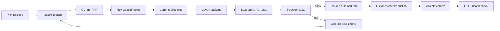

# DevOps lifecycle



## Local container lifecycle
```bash
mvn clean package
docker build -t consumer-complaint-portal:1.0 .
docker run -d --name complaint-portal -p 8080:8080 consumer-complaint-portal:1.0
docker logs -f complaint-portal
docker stop complaint-portal
docker start complaint-portal
docker rm -f complaint-portal
```

Keep the previous known-good image tag for rollback. If a health check fails, stop the new container and start the previous image. H2 in-memory data is not durable. For idempotency, run Ansible twice and compare changed/ok counts.