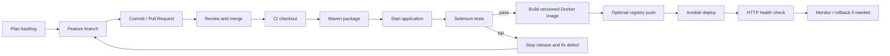

# DevOps Workflow and Operations Runbook

## Lifecycle diagram


## Local commands
```bash
mvn clean test
mvn -DskipTests package
docker build -t consumer-complaint-portal:1.0 .
docker run -d --name complaint-portal -p 8080:8080 consumer-complaint-portal:1.0
docker logs -f complaint-portal
docker stop complaint-portal
docker start complaint-portal
docker rm -f complaint-portal
```

## Jenkins prerequisites
Install JDK 17, Maven, Chrome/Chromium, Docker, Jenkins Pipeline and JUnit plugins. Create a Pipeline job from this repository. Ensure agent can run Docker. Optional Docker Hub publishing requires a Jenkins username/password credential with ID `dockerhub` and `DOCKERHUB_USER` configured securely.

## Ansible prerequisites
Install Ansible and `community.docker` collection. Replace the sample IP in `ansible/inventory.ini` with a host you administer. Configure SSH/sudo. Note: current playbook builds image on the controller then starts container on target; ensure Docker SDK and a reachable registry/image transfer strategy are configured for that topology before relying on it.

## Health and rollback
Check HTTP 200 at the deployed root page. Keep the previous known-good image tag. If new release fails health check, stop it and start the prior version. H2 in-memory storage is not durable; a real rollback requires durable DB migration/backups.

## Container lifecycle
Record actual outputs of `docker images`, `docker ps -a`, `docker logs`, stop/start/remove commands and include sanitized screenshots. These commands are a runbook, not proof that a container has run.
