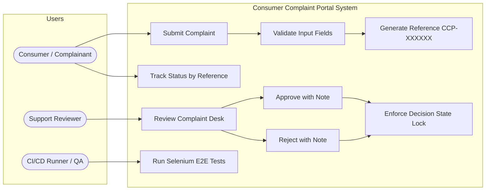
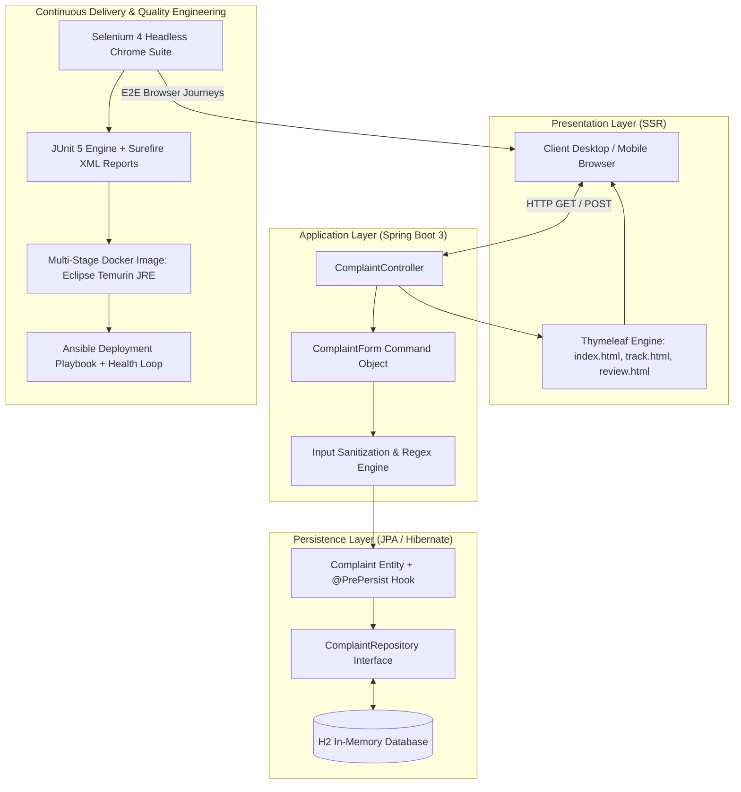
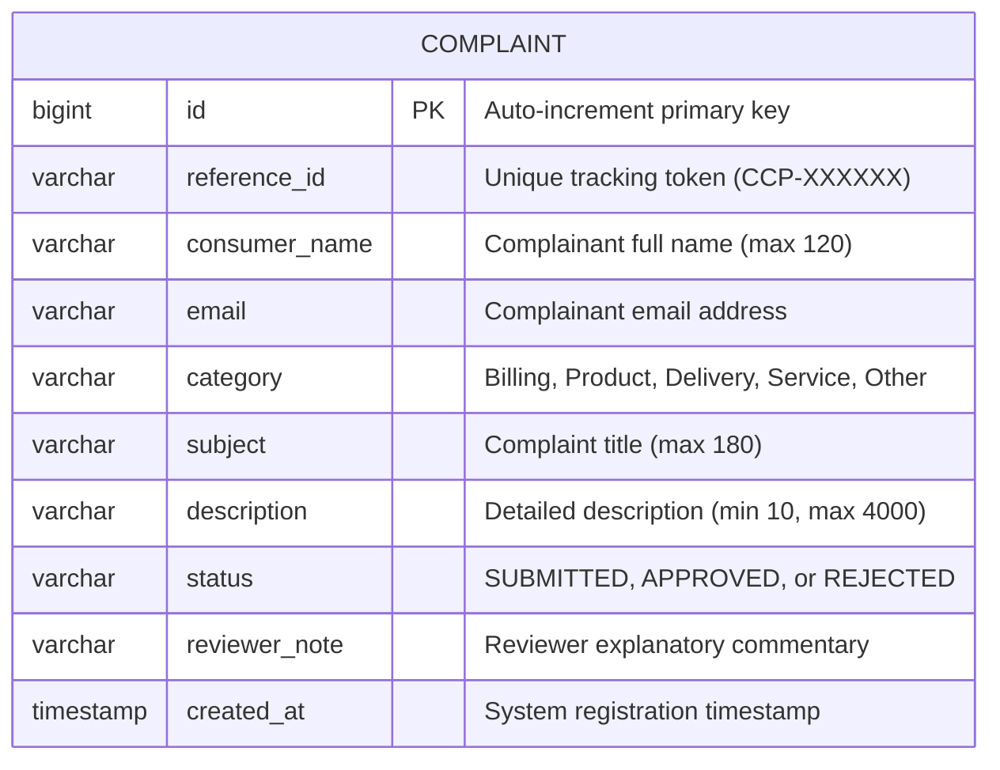
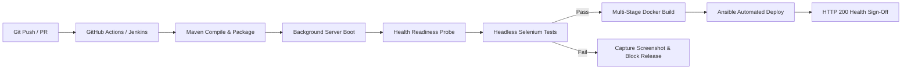

# Software Requirements Specification (SRS)

**Project Name:** Consumer Complaint Portal — Selenium Testing and DevOps
**Student Name:** Harshad Ahire · **Roll Number:** 23102C0056
**GitHub Repository:** [https://github.com/ahireharshad/consumer-complaint-portal-devops](https://github.com/ahireharshad/consumer-complaint-portal-devops)
**Document Version:** 1.1 (Phase 1 Baseline & Verification Update)

---

## 1. Purpose and Scope

The **Consumer Complaint Portal** is a web-based grievance redressal system designed to standardize how consumer issues are reported, validated, assigned tracking codes, and adjudicated. In addition to core business functionality, it serves as an academic DevOps reference project implementing Selenium 4 automated browser testing, CI/CD pipeline automation, Docker containerization, and Ansible host deployment.

### System Scope
- Public intake form with client and server-side data sanitization and validation.
- Auto-generation of tracking reference numbers (`CCP-XXXXXX`).
- Real-time status lookup with timestamp and reviewer notes.
- Administrative reviewer desk supporting `APPROVED` and `REJECTED` decisions.
- Backend state transition locks ensuring final decisions cannot be overwritten.
- Multi-browser automated testing with failure screenshot capture.

### Excluded from Scope
- User authentication, role-based access control (RBAC), and session management.
- Multi-part file/document attachment uploads.
- Durable relational disk storage (uses in-memory H2 for zero-dependency portability).
- Third-party email, SMS, or webhook notification dispatchers.

---

## 2. Functional Requirements

| Requirement ID | Description | Implementation Details | Status |
|---|---|---|---|
| **FR-01** | Display Complaint Form | Render clean intake form with fields: Full Name, Email, Category, Subject, Description | **VERIFIED** |
| **FR-02** | Server-Side Validation | Validate non-blank inputs, regex email format (`^[^\\s@]+@[^\\s@]+\\.[^\\s@]+$`), and min 10 characters for description | **VERIFIED** |
| **FR-03** | Reference Assignment | Generate unique identifier (`CCP-XXXXXX`) using `@PrePersist` lifecycle hook before committing to database | **VERIFIED** |
| **FR-04** | Status Tracking Engine | Query complaint by reference ID and display category, subject, creation timestamp, status, and reviewer notes | **VERIFIED** |
| **FR-05** | Reviewer Desk Adjudication | List all complaints in dashboard; allow reviewer to input notes and select `Approve` or `Reject` | **VERIFIED** |
| **FR-06** | Invalid Reference Handling | Return user-friendly alert message (`No complaint found for that reference.`) for unknown reference lookups | **VERIFIED** |
| **FR-07** | State Transition Immutability | Enforce that complaints with `APPROVED` or `REJECTED` status cannot be modified or re-adjudicated | **VERIFIED** |

---

## 3. Non-Functional Requirements

- **NFR-01 (Runtime & Portability):** Built on Java 17+ (tested on Java 25 LTS) and Spring Boot 3.3.5. Runs independently via executable fat JAR.
- **NFR-02 (Responsiveness & UI Design):** Clean CSS embedded in Thymeleaf templates with responsive viewport meta tags and system font stacks.
- **NFR-03 (Configurability):** Application port and database URL are externally configurable via `${PORT:8080}` and `${DB_URL:...}`.
- **NFR-04 (Automated Testing):** Selenium 4.25.0 test suite with headless Chrome, explicit `WebDriverWait` polling, and JUnit XML report generation.
- **NFR-05 (Defect Diagnostics):** Automated failure screenshot capture saving timestamped PNG files under `target/screenshots/` upon test failure.
- **NFR-06 (Security Isolation):** Multi-stage container packaging enforcing unprivileged non-root user (`uid 10001 appuser`) and cgroup RAM limits.

---

## 4. Use Case Diagram



---

## 5. System Architecture Diagram



---

## 6. Relational Data Model



### Allowed Status Transitions
```
[Intake] ──▶ (SUBMITTED) ──┬──▶ [Reviewer Approve] ──▶ (APPROVED) [FINAL LOCK]
                           │
                           └──▶ [Reviewer Reject]  ──▶ (REJECTED) [FINAL LOCK]
```

---

## 7. DevOps Delivery Lifecycle



---

## 8. API & Route Directory

| Method | Path | Request Body / Parameters | Model Output / Redirect | Purpose |
|---|---|---|---|---|
| `GET` | `/` | None | `complaint` (empty form) | Displays complaint submission form |
| `POST` | `/complaints` | `name, email, category, subject, description` | `submittedReference` or `error` | Validates, persists complaint, returns reference |
| `GET` | `/track` | Query: `reference` (optional) | `result` (Complaint entity or null) | Queries complaint details and current status |
| `GET` | `/review` | None | `complaints` (List of Complaint) | Displays administrative triage dashboard |
| `POST` | `/review/{id}/APPROVED` | Form: `note` (optional) | `302 Redirect -> /review` | Approves complaint and records note |
| `POST` | `/review/{id}/REJECTED` | Form: `note` (optional) | `302 Redirect -> /review` | Rejects complaint and records reason |
