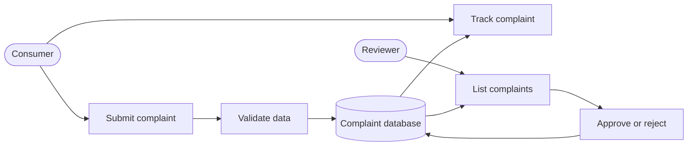
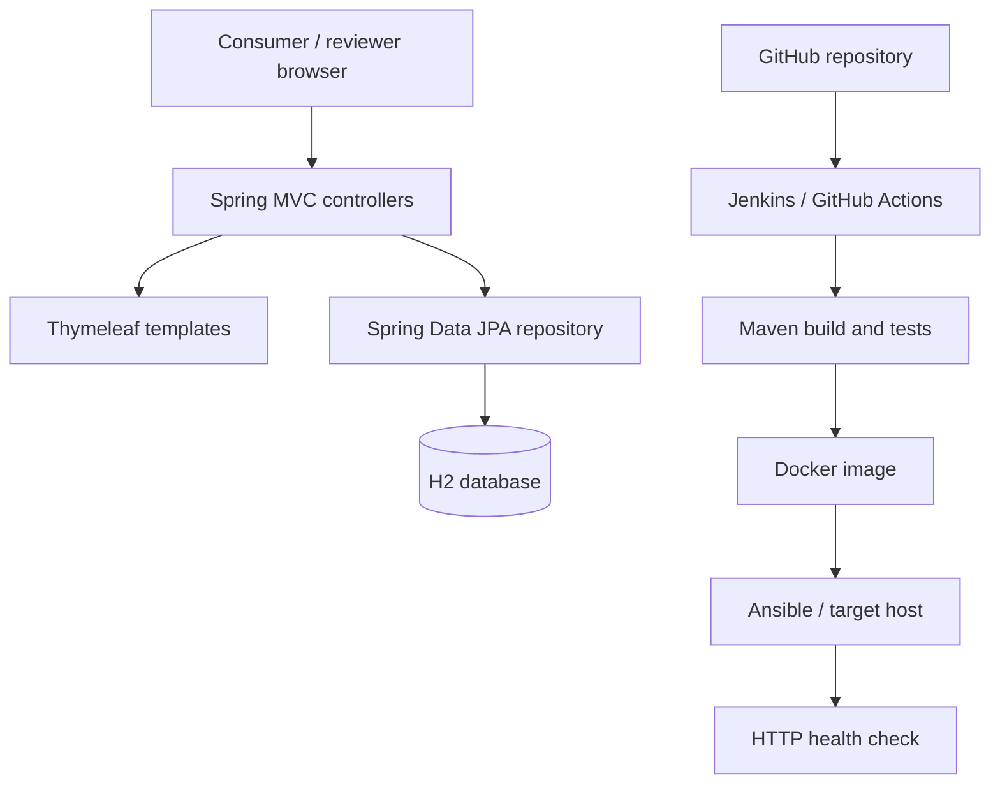
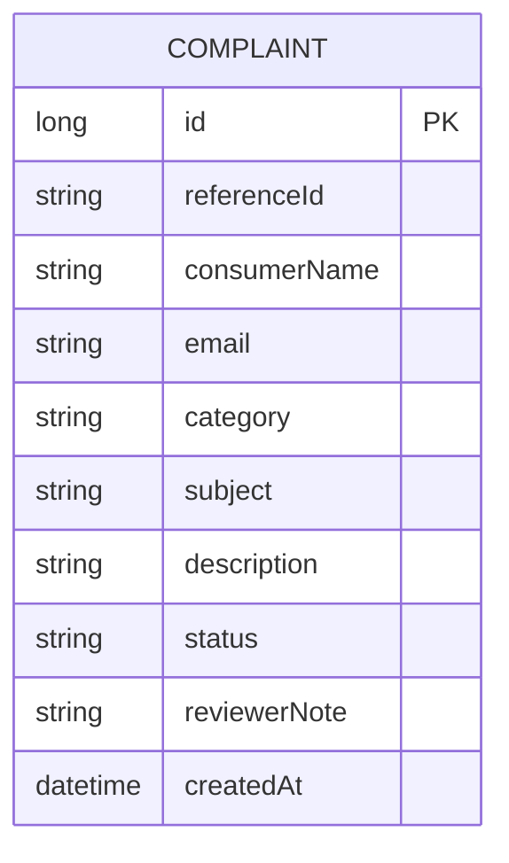

# Software Requirements Specification (SRS)

## 1. Purpose and scope
A browser-based MVP for submitting complaints, validating required data, assigning a reference, tracking status, and allowing a reviewer to approve/reject. Actual document uploads and user authentication are out of scope.

## 2. Functional requirements
- FR-01: Show complaint form for name, email, category, subject and description.
- FR-02: Reject missing required values, invalid email syntax and descriptions under 10 characters.
- FR-03: Persist accepted complaint and create a reference ID.
- FR-04: Find a complaint by reference and show status and complaint summary.
- FR-05: Reviewer can list complaints and decide APPROVED/REJECTED with a note.
- FR-06: Unknown reference shows a not-found message.
- FR-07: A decided complaint should not be decided again (target requirement; verify/strengthen controller implementation before claiming complete).

## 3. Non-functional requirements
- Java 17+, Spring Boot 3, Maven.
- Responsive HTML pages using Thymeleaf and semantic form labels.
- Configurable port and database URL.
- Maven Surefire JUnit XML report.
- No secrets in source control.
- Authentication, authorization, CSRF protection, rate limiting and durable storage are mandatory before production exposure.

## 4. Use cases

## 5. Architecture

## 6. Data model

Status values: SUBMITTED, APPROVED, REJECTED. The current reference generator is demo-grade; a production implementation should use a database uniqueness constraint and collision-safe ID generation.

## 7. API / route list
| Method | Path | Purpose |
|---|---|---|
| GET | / | Complaint form |
| POST | /complaints | Validate and save |
| GET | /track?reference=... | Lookup by reference |
| GET | /review | Reviewer list |
| POST | /review/{id}/APPROVED | Approve |
| POST | /review/{id}/REJECTED | Reject |

## 8. Validation and constraints
Server validates non-empty name/email/category/subject/description, email format, and description length >=10. The MVP does not upload files or collect identity/financial documents. Demo database is in-memory and resets at restart.
